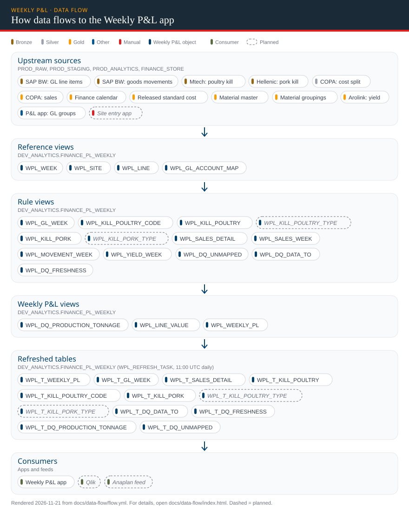

# Weekly P&L

This project moves the weekly P&L into Snowflake. Today, site finance teams spend one or two days each week building it by hand from SAP, Qlik and Excel. When this project is complete, the data is ready in Snowflake, and sites only check it, explain it and add the lines that are not in a system.

> **Start here:** open the map, [Weekly P&L v1 (#1)](https://github.com/Pilgrims-Europe/pilgrimseurope-weekly-profit-and-loss/issues/1). It shows the goal, the decisions so far and the open work.

---

## Contents

- [The goal](#the-goal)
- [The Weekly P&L app](#the-weekly-pl-app)
- [How the data flows](#how-the-data-flows)
- [Who does what](#who-does-what)
- [How we work](#how-we-work)
- [Git in 10 minutes](#git-in-10-minutes)
- [Repo layout](#repo-layout)
- [Rules for agents](#rules-for-agents)
- [Contacts](#contacts)

---

## The goal

The goal is a **v1 spec** for the weekly P&L. The spec gives:

1. The Snowflake data model.
2. The source of each P&L line, tagged as **system**, **calculated** or **manual**.
3. The site entry app, for the lines that are manual.
4. The feed from Snowflake into Anaplan.

We built **kill** first, as the proof of concept. Now the [Weekly P&L app](#the-weekly-pl-app) also shows the P&L lines for the pilot sites, Redruth and Bromborough.

How we deliver:

- **Small and fast.** Get numbers out, then get feedback. v1 does not have to be perfect.
- **Logic in Snowflake.** Qlik is for drill-down. Anaplan is for final reporting.
- **Share how you work.** Build with others on the call, so the team learns together.

Words like *weekly P&L*, *kill* and *run rate* have exact meanings. See [`GLOSSARY.md`](GLOSSARY.md).

---

## The Weekly P&L app

The app shows the Anaplan weekly template for one week, line by line, with the source, RAG and rule of each line. It also shows kill by kill site and day.

- App: `DEV_ANALYTICS.FINANCE_PL_WEEKLY.WEEKLY_PL` in Snowflake.
- Pages, RAG, data refresh and how to get access: see [`app/README.md`](app/README.md).
- The SQL that builds each line is in [`sql/`](sql/). Each line has its rule in the app, on the **Lines and rules** page.

To set up your computer, run the checks or run the app locally, see [`docs/dev-setup.md`](docs/dev-setup.md).

---

## How the data flows

The diagram shows each source, each Snowflake object and each consumer of the Weekly P&L app.

[](docs/data-flow/flow.svg)

**Interactive version.** Open `docs/data-flow/index.html` from your local copy of the repo, in a browser. Select an object to see what it reads and what reads it. GitHub shows the file as code, so open it from your laptop.

**When the flow changes.** If your change adds, removes or moves a source, object or consumer, do these steps in the same pull request:

1. Change [`docs/data-flow/flow.yml`](docs/data-flow/flow.yml).
2. Add a line with status `pending` to [`docs/data-flow/CHANGELOG.md`](docs/data-flow/CHANGELOG.md).

Do not change the diagram files. A GitHub Action renders them once a day and opens a pull request. To see your change before that, run `python scripts/render_flow.py --preview` (first run `pip install pyyaml`). It writes a copy to a temporary folder and does not change the repo.

---

## Who does what

Each piece of work is a GitHub **issue** (also called a **ticket**). All tickets belong to the [map (#1)](https://github.com/Pilgrims-Europe/pilgrimseurope-weekly-profit-and-loss/issues/1).

The links show the open tickets of each person, so they are always current.

| Person | Area | Open tickets |
| --- | --- | --- |
| **Chris** | Drives the map. Reviews pull requests. | [Chris's tickets](https://github.com/Pilgrims-Europe/pilgrimseurope-weekly-profit-and-loss/issues?q=is%3Aissue+is%3Aopen+assignee%3APEUcmccann) |
| **Emma** | Kill data. | [Emma's tickets](https://github.com/Pilgrims-Europe/pilgrimseurope-weekly-profit-and-loss/issues?q=is%3Aissue+is%3Aopen+assignee%3AEmmaCut1) |
| **Peter** | GL line items, sales and Qlik. | [Peter's tickets](https://github.com/Pilgrims-Europe/pilgrimseurope-weekly-profit-and-loss/issues?q=is%3Aissue+is%3Aopen+assignee%3Apnwora7) |
| **Jason** | Meetings with Gui. Site entry app design. | [Jason's tickets](https://github.com/Pilgrims-Europe/pilgrimseurope-weekly-profit-and-loss/issues?q=is%3Aissue+is%3Aopen+assignee%3AJason-Taylor90) |

Some tickets have no owner yet. Chris gives them an owner. See [tickets with no owner](https://github.com/Pilgrims-Europe/pilgrimseurope-weekly-profit-and-loss/issues?q=is%3Aissue+is%3Aopen+no%3Aassignee).

**Blocked tickets.** Some tickets must wait for others. GitHub shows a **Blocked by** box on the ticket. For example, [#75](https://github.com/Pilgrims-Europe/pilgrimseurope-weekly-profit-and-loss/issues/75) (production recovery) waits for [#74](https://github.com/Pilgrims-Europe/pilgrimseurope-weekly-profit-and-loss/issues/74) (top-level standard cost). Start the tickets that are not blocked first.

**Ticket types.** The label on each ticket tells you the type of work:

| Label | What you do |
| --- | --- |
| `wayfinder:research` | Find facts, for example which tables are in Snowflake. |
| `wayfinder:grilling` | Get a decision from a person, usually Gui. |
| `wayfinder:prototype` | Make a rough version to get feedback. |
| `wayfinder:task` | Do the work, for example build a table. |
| `bug` | A number in the app looks wrong. Check it. |
| `enhancement` | Make the app do more. |

Other labels, for example `needs-triage` and `ready-for-agent`, show the state of the ticket. See [`docs/agents/triage-labels.md`](docs/agents/triage-labels.md).

---

## How we work

Each ticket follows the same five steps.

1. **Open your ticket** on GitHub. Read the **Question**.
2. **Do the work** in Snowflake or Cortex Code. Ask Gui in the Teams chat if a business rule is not clear.
3. **Save files to Git** (SQL, app code, notes). See [Git in 10 minutes](#git-in-10-minutes).
4. **Write the answer** as a comment on the ticket. Keep it short. Link to your files.
5. **Close the ticket.** Click **Close issue**. Then tell Chris, so he can update the map.

If you cannot finish, write a comment that says what stops you. Do not close the ticket.

**Meetings.** We meet Gui every Wednesday at 3pm. Post findings in the Teams chat at any time; you do not need to wait for the meeting.

---

## Git in 10 minutes

Git keeps every version of our files, and it lets four people work at the same time without overwriting each other. You only need six commands.

> **Easy option:** In Cortex Code, you can ask the agent to do these steps for you. For example: *"Create a branch for issue 2, commit my changes and open a pull request."* The agent shows you each step before it does it.

### One-time setup

Do this once on your laptop. For the full setup (Snowflake, the app and the checks), see [`docs/dev-setup.md`](docs/dev-setup.md). Open a terminal in Cortex Code (**Terminal > New Terminal**).

```powershell
git config --global user.name "Your Name"
git config --global user.email "you@pilgrimseurope.com"
cd C:\Users\<you>\.Git
git clone https://github.com/Pilgrims-Europe/pilgrimseurope-weekly-profit-and-loss.git
cd pilgrimseurope-weekly-profit-and-loss
```

The first time you connect, a browser window asks you to sign in to GitHub. Sign in with your GitHub account.

### Every time you start a ticket

**1. Get the latest files.**

```powershell
git switch main
git pull
```

**2. Make a branch.** A branch is your own copy, so your changes do not affect the others until they are ready. Use your name and the ticket number.

```powershell
git switch -c emma/2-kill-data
```

**3. Do your work.** Add or change files in the repo folder.

**4. Save a version (commit).** Write one short line that says what you changed.

```powershell
git add .
git commit -m "Add kill data findings for issue 2"
```

You can commit many times. Each commit is a save point.

**5. Send it to GitHub (push).**

```powershell
git push -u origin emma/2-kill-data
```

**6. Ask for a review (pull request).** Git shows a link after the push. Open it, then click **Create pull request**. In the description, write `Closes #2` (use your ticket number). Fill in the sections of the template. Chris reviews it and merges it into `main`. The repo uses squash merge, so the title of the pull request becomes one commit on `main`.

**Pull request title.** Start the title with one type word and a colon. Then the reader knows what the pull request does before they open it.

| Type | Use it when | Example |
| --- | --- | --- |
| `Add` | You add a new line, tab, view, report or check. | `Add: pork kill by provenance` |
| `Fix` | A number or a behaviour was wrong. | `Fix: plan rows in the GL lines` |
| `Change` | A decided rule moves a number. The old number was not wrong. | `Change: count finished goods only in Production Tonnage` |
| `Research` | You add notes only. | `Research: finished goods write-offs` |
| `Docs` | You change the glossary, README, reports or questionnaires. | `Docs: status report for 2026-11-17` |
| `Tooling` | You change CI, scripts or upgrades. | `Tooling: upgrade Next.js to 16.4.6` |

A check on the pull request fails if the type word is missing. To fix it, edit the title. GitHub then adds a coloured `type:` label. Use one type for each pull request.

### If something goes wrong

| Problem | What to do |
| --- | --- |
| `git pull` says there is a conflict | Stop. Ask Chris or the Cortex Code agent. Do not delete files. |
| You committed on `main` by mistake | Stop. Do not push. Ask Chris. |
| You do not know which branch you are on | Run `git status`. The first line shows the branch. |
| You want to see your changes | Run `git status` and `git diff`. |

**There is no stupid question.** Ask in the Teams chat.

---

## Repo layout

```
/
├── README.md            ← you are here
├── GLOSSARY.md          ← exact meaning of project words
├── AGENTS.md            ← rules for the AI agents
├── app/                 ← the Weekly P&L app (Next.js), see app/README.md
├── sql/                 ← Snowflake SQL for the app, run in number order
│   └── checks/          ← tie-out and app contract checks
├── scripts/             ← build a test schema, run checks, deploy, render the data flow
├── research/            ← notes and findings from research tickets
├── reports/             ← HTML reports, for example status reports
├── questionnaires/      ← HTML forms with questions for Gui
├── docs/
│   ├── dev-setup.md     ← set up your computer and Cortex Code Desktop
│   ├── data-flow/       ← data flow diagram: flow.yml (source), CHANGELOG.md, flow.svg, index.html
│   ├── agents/          ← how agents use GitHub issues
│   ├── handoffs/        ← notes to hand work from one session to the next
│   └── meetings/, meeting-transcripts/ ← meeting transcripts
├── .cortex/skills/      ← report house style and templates
├── .vscode/             ← shared Run and Debug configurations and recommended extensions
└── .github/             ← pull request template and GitHub Actions
```

When you add work, put it in the folder above that fits. Reports and questionnaires use the house style in `.cortex/skills/pilgrims-reporting/`.

**Do not commit** passwords, keys or site data files (Excel, CSV). Gui's files go in SharePoint (see [#8](https://github.com/Pilgrims-Europe/pilgrimseurope-weekly-profit-and-loss/issues/8)).

---

## Rules for agents

The AI agents in Cortex Code read [`AGENTS.md`](AGENTS.md). Before an agent writes to Git or GitHub, it must:

- Start with one or two sentences of context.
- Write short, plain sentences (ASD-STE100 Simplified Technical English).
- Use the words in [`GLOSSARY.md`](GLOSSARY.md).
- Never add facts that it does not know. It writes "Unknown" or asks.
- Work in its own worktree, not in your main checkout.

If an agent reply is not clear, type `/wait-what` in the chat. The agent then explains it again in plain words.

---

## Contacts

| Who | Role |
| --- | --- |
| Gui (Guilherme De Marchi) | Business owner. Answers finance and process questions. |
| Luke Harrison | Sponsor. Sets priorities. |
| Chris McCann | Drives the map. Reviews pull requests. |
| Jason Taylor | Runs the meetings with Gui. Site entry app design. |
| Emma Cutler | Kill data and the kill proof of concept. |
| Peter Nwora | GL line items, sales and Qlik. |
| Aswani Nune | SAP BW Developer, IT. BW and SAP cost questions. |
| Tracy Conall | SAP questions. |
| Abhishek Mazumdar | FP&A Analyst, Finance Systems. Anaplan. |
| Simon Thompson | Head of Finance Systems. Anaplan. |
