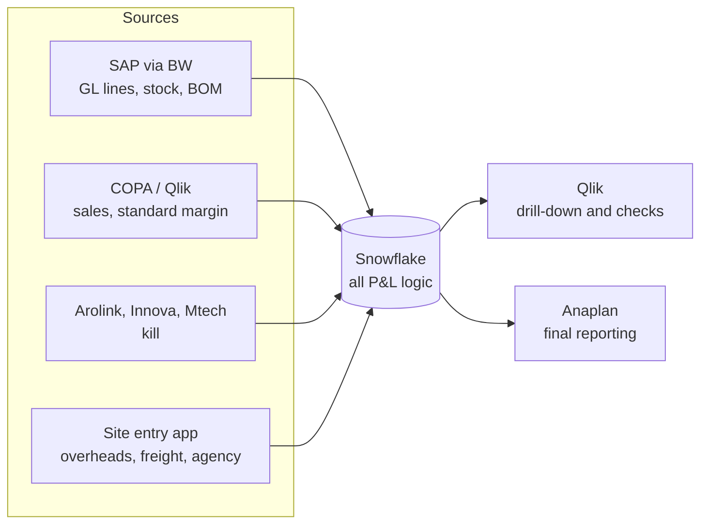

# Weekly P&L

This project moves the weekly P&L into Snowflake. Today, site finance teams spend one or two days each week building it by hand from SAP, Qlik and Excel. When this project is complete, the data is ready in Snowflake, and sites only check it, explain it and add the lines that are not in a system.

> **Start here:** open the map, [Weekly P&L v1 (#1)](https://github.com/Pilgrims-Europe/pilgrimseurope-weekly-profit-and-loss/issues/1). It shows the goal, the decisions so far and the open work.

---

## Contents

- [The goal](#the-goal)
- [How the data flows](#how-the-data-flows)
- [Who does what](#who-does-what)
- [How we work](#how-we-work)
- [Git in 10 minutes](#git-in-10-minutes)
- [Repo layout](#repo-layout)
- [Rules for agents](#rules-for-agents)
- [Contacts](#contacts)

---

## The goal

The goal is a **v1 spec** for the weekly P&L. The spec gives:

1. The Snowflake data model.
2. The source of each P&L line, tagged as **system**, **calculated** or **manual**.
3. The site entry app, for the lines that are manual.
4. The feed from Snowflake into Anaplan.

We build **kill** first, as the proof of concept. Kill data is already in Snowflake, so it is the quickest win.

How we deliver:

- **Small and fast.** Get numbers out, then get feedback. v1 does not have to be perfect.
- **Logic in Snowflake.** Qlik is for drill-down. Anaplan is for final reporting.
- **Share how you work.** Build with others on the call, so the team learns together.

Words like *weekly P&L*, *kill* and *run rate* have exact meanings. See [`GLOSSARY.md`](GLOSSARY.md).

---

## How the data flows



---

## Who does what

Each piece of work is a GitHub **issue** (also called a **ticket**). All tickets belong to the [map (#1)](https://github.com/Pilgrims-Europe/pilgrimseurope-weekly-profit-and-loss/issues/1).

| Person | Tickets |
| --- | --- |
| **Chris** (drives the map) | [Which stock movement and BOM data is in Snowflake? (#5)](https://github.com/Pilgrims-Europe/pilgrimseurope-weekly-profit-and-loss/issues/5)<br/>[How can Snowflake data load into Anaplan? (#7)](https://github.com/Pilgrims-Europe/pilgrimseurope-weekly-profit-and-loss/issues/7)<br/>[Tag each Anaplan line by source and RAG (#11)](https://github.com/Pilgrims-Europe/pilgrimseurope-weekly-profit-and-loss/issues/11) |
| **Emma** | [Which kill data is in Snowflake? (#2)](https://github.com/Pilgrims-Europe/pilgrimseurope-weekly-profit-and-loss/issues/2)<br/>[Build and check the weekly kill table (#10)](https://github.com/Pilgrims-Europe/pilgrimseurope-weekly-profit-and-loss/issues/10) |
| **Peter** | [Which GL line item data is in Snowflake? (#4)](https://github.com/Pilgrims-Europe/pilgrimseurope-weekly-profit-and-loss/issues/4)<br/>[Which sales and standard margin data is in Snowflake? (#6)](https://github.com/Pilgrims-Europe/pilgrimseurope-weekly-profit-and-loss/issues/6) |
| **Jason** | [What is the kill definition for pork? (#3)](https://github.com/Pilgrims-Europe/pilgrimseurope-weekly-profit-and-loss/issues/3)<br/>[Get Gui's files for the team (#8)](https://github.com/Pilgrims-Europe/pilgrimseurope-weekly-profit-and-loss/issues/8)<br/>[What should the site entry screen look like? (#9)](https://github.com/Pilgrims-Europe/pilgrimseurope-weekly-profit-and-loss/issues/9) |

To see only your tickets, open [Issues](https://github.com/Pilgrims-Europe/pilgrimseurope-weekly-profit-and-loss/issues) and click **Assignee**, then your name.

**Blocked tickets.** Some tickets must wait for others. GitHub shows a **Blocked by** box on the ticket. For example, *Build and check the weekly kill table* waits for the kill data and the pork kill definition. Start the tickets that are not blocked first.

**Ticket types.** The label on each ticket tells you the type of work:

| Label | What you do |
| --- | --- |
| `wayfinder:research` | Find facts, for example which tables are in Snowflake. |
| `wayfinder:grilling` | Get a decision from a person, usually Gui. |
| `wayfinder:prototype` | Make a rough version to get feedback. |
| `wayfinder:task` | Do the work, for example build a table. |

---

## How we work

Each ticket follows the same five steps.

1. **Open your ticket** on GitHub. Read the **Question**.
2. **Do the work** in Snowflake or Cortex Code. Ask Gui in the Teams chat if a business rule is not clear.
3. **Save files to Git** (SQL, app code, notes). See [Git in 10 minutes](#git-in-10-minutes).
4. **Write the answer** as a comment on the ticket. Keep it short. Link to your files.
5. **Close the ticket.** Click **Close issue**. Then tell Chris, so he can update the map.

If you cannot finish, write a comment that says what stops you. Do not close the ticket.

**Meetings.** We meet Gui every Wednesday at 3pm. Post findings in the Teams chat at any time; you do not need to wait for the meeting.

---

## Git in 10 minutes

Git keeps every version of our files, and it lets four people work at the same time without overwriting each other. You only need six commands.

> **Easy option:** In Cortex Code, you can ask the agent to do these steps for you. For example: *"Create a branch for issue 2, commit my changes and open a pull request."* The agent shows you each step before it does it.

### One-time setup

Do this once on your laptop. Open a terminal in Cortex Code (**Terminal > New Terminal**).

```powershell
git config --global user.name "Your Name"
git config --global user.email "you@pilgrimseurope.com"
cd C:\Users\<you>\.Git
git clone https://github.com/Pilgrims-Europe/pilgrimseurope-weekly-profit-and-loss.git
cd pilgrimseurope-weekly-profit-and-loss
```

The first time you connect, a browser window asks you to sign in to GitHub. Sign in with your GitHub account.

### Every time you start a ticket

**1. Get the latest files.**

```powershell
git switch main
git pull
```

**2. Make a branch.** A branch is your own copy, so your changes do not affect the others until they are ready. Use your name and the ticket number.

```powershell
git switch -c emma/2-kill-data
```

**3. Do your work.** Add or change files in the repo folder.

**4. Save a version (commit).** Write one short line that says what you changed.

```powershell
git add .
git commit -m "Add kill data findings for issue 2"
```

You can commit many times. Each commit is a save point.

**5. Send it to GitHub (push).**

```powershell
git push -u origin emma/2-kill-data
```

**6. Ask for a review (pull request).** Git shows a link after the push. Open it, then click **Create pull request**. In the description, write `Closes #2` (use your ticket number). Chris reviews it and merges it into `main`.

### If something goes wrong

| Problem | What to do |
| --- | --- |
| `git pull` says there is a conflict | Stop. Ask Chris or the Cortex Code agent. Do not delete files. |
| You committed on `main` by mistake | Stop. Do not push. Ask Chris. |
| You do not know which branch you are on | Run `git status`. The first line shows the branch. |
| You want to see your changes | Run `git status` and `git diff`. |

**There is no stupid question.** Ask in the Teams chat.

---

## Repo layout

```
/
├── README.md        ← you are here
├── GLOSSARY.md      ← exact meaning of project words
├── AGENTS.md        ← rules for the AI agents
└── docs/agents/     ← how agents use GitHub issues
```

When you add work, use these folders. Make the folder if it does not exist.

| Folder | What goes in it |
| --- | --- |
| `sql/` | Snowflake SQL: tables, views, checks |
| `apps/` | Streamlit apps, for example the site entry app |
| `research/` | Notes and findings from research tickets |

**Do not commit** passwords, keys or site data files (Excel, CSV). Gui's files go in SharePoint (see [#8](https://github.com/Pilgrims-Europe/pilgrimseurope-weekly-profit-and-loss/issues/8)).

---

## Rules for agents

The AI agents in Cortex Code read [`AGENTS.md`](AGENTS.md). Before an agent writes to Git or GitHub, it must:

- Start with one or two sentences of context.
- Write short, plain sentences (ASD-STE100 Simplified Technical English).
- Use the words in [`GLOSSARY.md`](GLOSSARY.md).
- Never add facts that it does not know. It writes "Unknown" or asks.

If an agent reply is not clear, type `/wait-what` in the chat. The agent then explains it again in plain words.

---

## Contacts

| Who | Role |
| --- | --- |
| Gui (Guilherme De Marchi) | Business owner. Answers finance and process questions. |
| Luke Harrison | Sponsor. Sets priorities. |
| Chris McCann | Drives the map. Reviews pull requests. |
| Jason Taylor | Runs the meetings with Gui. Site entry app design. |
| Emma Cutler | Kill data and the kill proof of concept. |
| Peter Nwora | GL line items, sales and Qlik. |
| Aswani | BW questions. |
| Tracy Conall | SAP questions. |
| Abhishek, Simon | Anaplan. |
